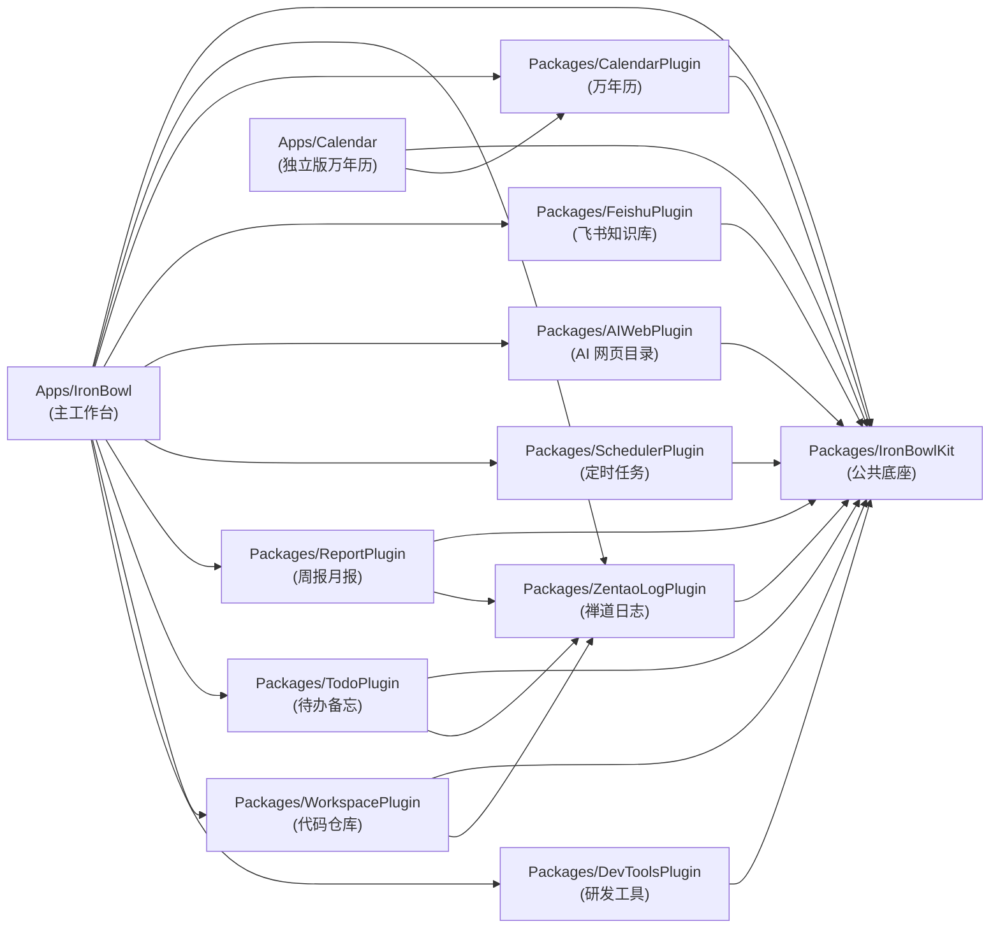

# 架构总览

IronBowl 采用 **「公共底座（`IronBowlKit`） + 独立功能包（`*Plugin`） + 轻量宿主（`Apps/*`）」** 的模块化架构，所有工程配置由根目录 [`project.yml`](../../project.yml) 声明，并通过 XcodeGen 生成 `IronBowl.xcodeproj`。

## 工程技术栈与构建配置

- **目标平台**：macOS 26.0+，原生 SwiftUI + AppKit 混编（窗口控制、菜单栏面板、`NSPanel`、`WKWebView`）。
- **Swift 并发模型**（见 [`project.yml`](../../project.yml) 与各 `Package.swift`）：
  - `SWIFT_VERSION: "6.0"`（Package manifest 使用 `swift-tools-version: 6.2`）
  - 默认主线程隔离：`SWIFT_DEFAULT_ACTOR_ISOLATION: MainActor`（Package target 中对应 `.defaultIsolation(MainActor.self)`）
  - `SWIFT_APPROACHABLE_CONCURRENCY: YES`（Package target 中对应 `.enableUpcomingFeature("NonisolatedNonsendingByDefault")`）
  - 计算密集或 I/O 异步工具（如 `Shell`、`AIRunner`、`GitScanner`、`HolidayFetcher`、`WeatherService`）显式标注 `nonisolated` 或 `@concurrent`。
- **签名与权限**：本地 ad-hoc 签名（`CODE_SIGN_IDENTITY: "-"`），关闭 App Sandbox（`ENABLE_APP_SANDBOX: NO`）与 Hardened Runtime（`ENABLE_HARDENED_RUNTIME: NO`），以便直接扫描本地 Git 仓库并调用本机 `git`、`agy`、`codex` CLI。
- **持久化依赖**：GRDB 7.x（`GRDB.swift`）。

## 模块依赖关系

## 目录职责划分

| 路径 | 类型 | 职责说明 |
| :--- | :--- | :--- |
| `Apps/IronBowl` | macOS App (`com.taopaox.ironbowl`) | 组装全部插件，提供主窗口、首页、设置窗口、菜单栏面板与 Dock/开机自启控制 |
| `Apps/Calendar` | macOS App (`com.taopaox.ironbowl.calendar`) | 只依赖 `IronBowlKit` + `CalendarPlugin`，提供轻量独立菜单栏万年历与开机自启设置，与主应用共享同一数据库 |
| `Packages/IronBowlKit` | Swift Package | 提供插件协议、数据库、强类型设置、开机自启控制器（`LaunchAtLoginController`）、工作日历、AI 执行器、网页墓碑、定时任务调度器（`TaskScheduler`）、系统资源监控（`SystemMonitor`）、跨模块全文检索（`WorkspaceSearchEngine`）、提醒中心与 `DS*` 设计系统 |
| `Packages/ZentaoLogPlugin` | Swift Package | Git 仓库扫描、AI 工作日志与加班拆条生成、禅道 JSON 接口客户端、工时提醒与定时自动提交动作 |
| `Packages/CalendarPlugin` | Swift Package | 公历/农历/24 节气/节日历法、Open-Meteo 与和风天气、月历主视图与 5 套配色弹层 |
| `Packages/FeishuPlugin` | Swift Package | 内嵌飞书网页浏览、上传下载、自定义主页与固定网页到主窗口侧边栏 |
| `Packages/AIWebPlugin` | Swift Package | 20 个内置 AI 网站目录、可折叠侧栏子项、官方 Logo 与自定义图标抓取 |
| `Packages/SchedulerPlugin` | Swift Package | 定时任务管理页面、任务编辑弹窗、执行日志审计与调度引擎生命周期控制 |
| `Packages/ReportPlugin` | Swift Package | 按周/月查询每日日报（禅道/本地提交/草稿）、AI 与规则汇总生成周报和月报、预览编辑及 Markdown 导出 |
| `Packages/TodoPlugin` | Swift Package | 待办与日程备忘管理、定时提醒、随手便签与剪贴板暂存板、一键转入禅道日报草稿 |

## 插件协议与生命周期

所有功能模块均实现 [`IronBowlPlugin`](../../Packages/IronBowlKit/Sources/IronBowlKit/Core/Plugin.swift) 协议，由宿主 `AppModel` 统一管理启停与界面挂载。

### `IronBowlPlugin` 核心能力

- **基础身份**：`id`、`title`、`sidebarTitle`、`sidebarSection`、`systemImage`、`isComingSoon`、`isSidebarDirectory`、`migrations`。
  - `sidebarTitle` 默认回退到 `title`（例如 `ZentaoLogPlugin` 的 `title` 为 `"禅道日志"`，`sidebarTitle` 为 `"日报"`）。
  - `sidebarSection` 为 `nil` 或空白时显示在左侧栏顶部主列表；指定分组名后通过 `SidebarPluginGrouping.partition(_:)` 归组展示在独立 `DSSidebarSection` 分区下（如 `"汇报"` 分组包含日报、周报、月报）。
- **生命周期**：
  - `start(context: PluginContext)`：插件启用并启动时调用一次，注入共享服务与导航回调。
  - `stop()`：插件停用或应用退出清理时调用，用于停止定时器并释放 `WebSessionManager` 持有会话。
- **界面与入口扩展**：
  - `makeMainView()`：插件主内容区视图。
  - `settingsPages`：自动注入设置窗口左侧插件分组。
  - `menuBarItems`：暴露给菜单栏和「设置 → 通用 → 菜单栏显示」的可选信息项。
  - `sidebarPinnedItems`：显示在主窗口侧边栏「固定网页」分区（支持重命名、排序、休眠与右键菜单）。
  - `sidebarChildren`：配合 `isSidebarDirectory == true` 在侧栏插件项下方缩进展示可折叠子项。
  - `quickActions` / `homeCards` / `paletteCommands` / `handleHomeInput(_:)`：注入首页「今天」的快捷标签、概览卡片、全局 `⌘K` 命令面板子命令（如飞书固定页、AI 目录站点、本地仓库快捷启动）与一句话输入处理链。

### `PluginContext` 共享服务

宿主通过 `PluginContext` 向每个插件提供统一能力：

| 属性 | 类型 | 用途 |
| :--- | :--- | :--- |
| `database` | `AppDatabase` | 访问共享 SQLite（GRDB `DatabasePool`） |
| `settings` | `SettingsStore` | 读写 JSON 序列化设置项并触发 SwiftUI 响应 |
| `reminders` | `ReminderCenter` | 发送系统通知或浮动提醒面板 |
| `workCalendar` | `WorkCalendar` | 查询工作日/调休/节假日与默认工时 |
| `providers` | `AIProviderStore` | 读取默认与各 AI CLI 配置 |
| `webSessions` | `WebSessionManager` | 创建与复用受全局墓碑策略托管的网页会话 |
| `scheduler` | `TaskScheduler` | 注册定时任务动作、写入默认定时任务并统一调度执行 |
| `todos` | `TodoStore` | 读写跨应用共享的待办与备忘数据并触发跨进程同步 |
| `scratchpad` | `ScratchpadStore` | 读写随手便签与剪贴板暂存数据 |
| `clipboard` | `ClipboardHistoryStore` | 监听剪贴板历史、过滤敏感类型与管理常用片段库 |
| `openPlugin` | `(String) -> Void` | 跳转到指定插件主视图并激活主窗口 |
| `openSettings` | `(String?) -> Void` | 打开设置窗口并定位到指定设置页 ID |
| `openChatInWorkspace` | `(String) -> Void` | 切到首页「今天」并绑定指定仓库目录发起对话 |
| `appendDailyLogDraft` | `((String, Double, Date) -> Bool)?` | 允许万年历等解耦插件按日期追加禅道日报草稿（独立版中为 `nil`） |

### 运行时注册与占位插件

在 [`AppModel.swift`](../../Apps/IronBowl/AppModel.swift) 中注册当前插件顺序为：
1. `ZentaoLogPlugin`（`zentao.log`）
2. `CalendarPlugin`（`calendar`）
3. `FeishuPlugin`（`feishu`）
4. `AIWebPlugin`（`aiweb`）
5. `SchedulerPlugin`（`scheduler`）
6. `ReportPlugin`（`report`，周报）
7. `MonthlyReportPlugin`（`report.monthly`，月报）
8. `WorkLedgerPlugin`（`report.stats`，牛马账本）
9. `AnnualReviewPlugin`（`report.annual`，季度/年报）
10. `TodoPlugin`（`todo`，待办）
11. `ScratchpadPlugin`（`scratchpad`，随手便签）
12. `WorkspacePlugin`（`workspace`，代码仓库）
13. `DevToolsPlugin`（`devtools`，研发工具）

当应用版本升级引入新插件 ID 时，`AppModel` 会比对 `app.knownPlugins` 与 `app.enabledPlugins`，自动将新增插件加入已启用列表，避免老用户升级后看不到新插件。
