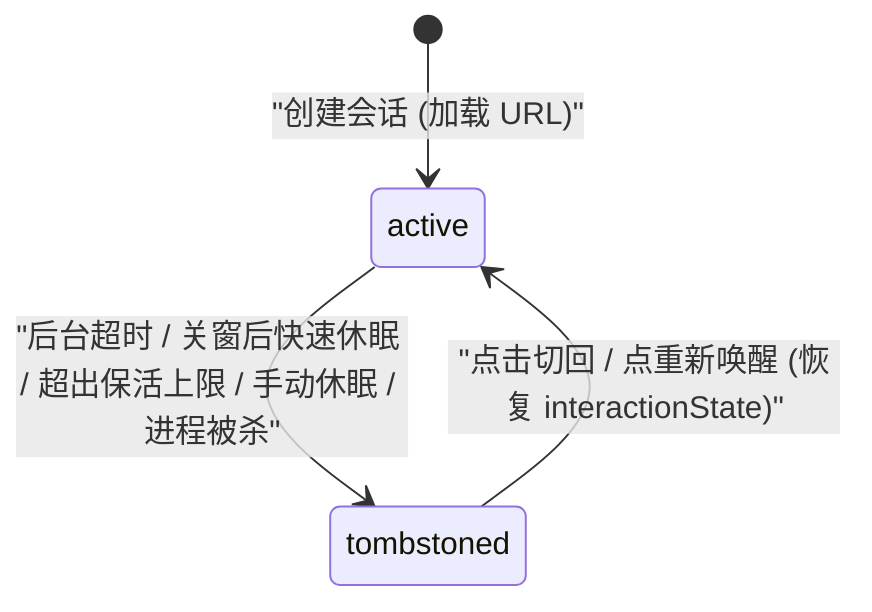

# 网页与墓碑机制（`WebSessionManager`）

内嵌网页底座位于 `Packages/IronBowlKit/Sources/IronBowlKit/Web/`，由 `WebSessionManager`、`WebSession`、`WebContainerView` 与 `WebURL` 组成，为「飞书知识库」「AI 目录」等所有内嵌网页插件提供统一的仿 Chrome 内存节省（墓碑机制）。

## 配置项（`WebKeys`）

| 设置键 | 默认值 | 说明 |
| :--- | :--- | :--- |
| `web.tombstone.enabled` | `true` | 全局启用或关闭自动休眠 |
| `web.tombstone.idleMinutes` | `5` | 后台闲置超过该分钟数自动休眠（`0` 表示不按时长回收） |
| `web.tombstone.windowCloseSeconds` | `60` | 主窗口关闭退回菜单栏后超过该秒数自动休眠可休眠网页（`0` 表示跟随后台闲置时长） |
| `web.tombstone.maxLiveCount` | `2` | 最多同时保活的 `WKWebView` 数量，超出后按 LRU 淘汰后台页面（`0` 表示不限） |

统一配置入口位于工作台「设置 → 网页与内存」，支持查看保活/休眠数、立即休眠后台网页、全部刷新以及清空 `WKWebsiteDataStore.default()` 全站缓存。

## 墓碑休眠与唤醒流程

1. **安全跳过条件（`WebSession.canAutoSuspend()`）**：当前可见（`isVisible == true`）、用户设为「免休眠」（`neverSuspend == true`）、正在使用摄像头/麦克风（`.active`）或正在播放音视频（`requestMediaPlaybackState() == .playing`）的页面，不会自动休眠。
2. **主窗口关闭快速回收（`WebSessionManager.setHostWindowOpen(_:now:)`）**：主窗口关闭退回菜单栏时调用 `detachAllDisplays()` 并将 `isHostWindowOpen` 设为 `false`，调度定时任务在 `windowCloseSeconds`（默认 `60` 秒）后执行 `sweep()`，自动休眠可休眠网页；若期间主窗口重新打开，则取消该定时任务并恢复 `isHostWindowOpen = true`。
3. **进入墓碑（`suspendToTombstone`）**：
   - 先截取当前页面快照 `snapshot`（`takeSnapshot`），并保存 `WKWebView.interactionState`（完整前进/后退历史栈）。
   - 拆除并置空 `WKWebView`，释放 WebContent 进程内存，状态切换为 `.tombstoned`，`WebContainerView` 展示低透明度快照与「重新唤醒」卡片（当调用方传入 `onClose` 回调时，卡片同时提供「关闭网页」按钮以直接销毁会话）。
4. **无感唤醒（`wakeIfNeeded`）**：
   - 重新切回或主窗口关闭再打开时，立即重建 `WKWebView` 并回填 `savedInteractionState`。
   - 唤醒期间叠加原快照防白屏（`isWakingUp`），导航完成后平滑淡出，并设 2.5 秒兜底定时器 `scheduleWakeFallback()` 避免长时间遮挡。
5. **崩溃兜底（`webViewWebContentProcessDidTerminate`）**：若页面在可见态被系统终止渲染进程则自动 `reload()`；若在后台被杀则转入墓碑状态等待下次切回唤醒。
6. **会话状态查询与销毁**：`WebSessionManager.hasSession(id:)` 结合可观测的 `sessionIDs` 实时反映网页是否已打开（含休眠态），`remove(id:)` 触发 `WebSession.teardown()` 并移除会话。
7. **进程归因与通用交互**：`WebSession` 记录 `displayName`（由飞书、AI 目录等插件传入可读名称），`WebSessionManager.activeWebProcessDescriptors()` 汇总活跃渲染进程 PID 与页面状态供 `SystemMonitor` 展示逐网页资源明细；共享 `WKWebsiteDataStore.default()` 登录态；支持 `WKUIDelegate` JS 弹窗与 `NSOpenPanel` 上传、`WKDownloadDelegate` + `NSSavePanel` 下载；支持 `blockedSchemes` 屏蔽外部桌面端唤起（如飞书的 `feishu://`、`lark://`）。
